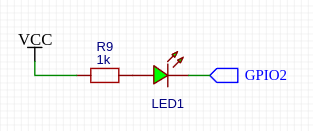

# API библиотеки

## Оглавление

- [Описание](#описание)
- [Конструктор объекта](#конструктор-объекта)
- [Инициирование модуля и загрузка параметров](#инициирование-модуля-и-загрузка-параметров)
- [Обработка событий модуля](#обработка-событий-модуля)
- [Настройка сетевых параметров](#настройка-сетевых-параметров)
  - [SSID и пароль WiFi-сети](#ssid-и-пароль-wifi-сети)
  - [Параметры WiFi-сети со статическим IP](#параметры-wifi-сети-со-статическим-ip)
- [Настройки точки доступа](#настройки-точки-доступа)
  - [Имя и пароль точки доступа](#имя-и-пароль-точки-доступа)
  - [Параметры сети точки доступа](#параметры-сети-точки-доступа)
- [Комбинированный режим](#комбинированный-режим)
- [Прочие сетевые настройки](#прочие-сетевые-настройки)
- [Параметры безопасности](#параметры-безопасности)
- [Работа с сетью](#работа-с-сетью)
- [Работа с Web-интерфейсом](#работа-с-web-интерфейсом)
- [Сохранение параметров](#сохранение-параметров)
  - [EEPROM](#eeprom)
  - [Файлы настроек](#файлы-настроек)
  - [Сохранение и загрузка параметров](#сохранение-и-загрузка-параметров)
- [Прочие методы](#прочие-методы)
  - [Вывод отладочной информации](#вывод-отладочной-информации)
  - [Использование индикаторного светодиода](#использование-индикаторного-светодиода)
- [Смотри также](#смотри-также)

<hr>

### Описание

Основной класс библиотеки - `shWiFiConfig`. Приведенные ниже методы предназначены для взаимодействия со сторонним программным кодом, в том числе для программной настройки работы модуля.

***Важно!!!** большая часть настроек модуля доступна через Web-интерфейс; исключительно программно устанавливаются только следующие настройки:*
- включение/выключение вывода отладочных сообщений о работе модуля;
- включение/выключение шифрования паролей при сохранении;
- инициализация EEPROM; установка стартового индекса для сохранения данных в EEPROM;
- включение возможности использования комбинированного режима (AP + STA);
- включение возможности использования индикаторного светодиода;
- настройка параметров яркости светодиода;

Остальные настройки доступны через Web-интерфейс модуля. Доступ интерфейса по умолчанию осуществляется по адресу
```
 http://your_ip/wifi_config
```
 где **your_ip** - IP-адрес модуля.

### Конструктор объекта

создание объекта
```
shWiFiConfig wifi_config;
shWiFiConfig wifi_config(adm_name, adm_pass);
```
здесь:
- `adm_name` - логин для входа в Web-интерфейс
- `adm_pass` - пароль для входа в Web-интерфейс

***ВАЖНО!!!** конструктор принимает аргументы по ссылке (`String &`), поэтому передавать нужно именованные переменные типа `String`, а не строковые литералы. Вариант `shWiFiConfig wifi_config("admin", "password");` **не скомпилируется**.*

<hr>

### Инициирование модуля и загрузка параметров
```
// с сохранением настроек в EEPROM
void begin(shWebServer *_server, const String &_config_page = "/wifi_config");

// с сохранением настроек в файловой системе
void begin(shWebServer *_server, FS *_file_system, const String &_config_page = "/wifi_config");
```
здесь:
- `_server` - ссылка на экземпляр Web-сервера, с которым будет работать конфиг
- `_file_system` - ссылка на экземпляр файловой системы модуля для сохранения файла с настройками
- `_config_page` - адрес страницы Web-интерфейса модуля

***Важно!!!** при хранении параметров в файле вызывать метод `begin()` можно только после успешной инициализации файловой системы*

***Примечание:** если модуль не находит файла конфигурации или сохраненных в `EEPROM` данных, то он сохранит параметры по умолчанию*

<hr>

### Обработка событий модуля

```
void tick();
```

***Примечание:** метод должен вызываться как можно чаще, по крайней мере не реже одного раза за милисекунду; внутри обрабатываются HTTP-запросы веб-сервера и (при истечении интервала, заданного через `setCheckTimer()`) вызывает `checkStaConnection()`*

```
void loop()
{
  wifi_config.tick();
}
```

### Настройка сетевых параметров

#### SSID и пароль WiFi-сети

установка данных для подключения к WiFi-сети
```
void setStaSsidData(String &ssid, String &pass);
void setStaSsid(String &sta_ssid);
void setStaPass(String &sta_pass);
```
здесь
- `ssid`, `sta_ssid` - имя сети (SSID)
- `pass`, `sta_pass` - пароль для подключения к сети

***Важно!!!** - контроль длины имени и пароля не осуществляется исходя из логики, что они были заданы в другом месте, на другом устройстве и скорее всего другими людьми; контроль за использованием недопустимых символов так же не ведется*

<hr>

получение текущих данных для подключения к  WiFi-сети
```
String getStaSsid();
String getStaPass();
```

<hr>

#### Параметры WiFi-сети со статическим IP

включить/отключить ручную установку IP-адреса, с которой модуль будет подключаться к заданной WiFi-сети
```
void setStaticIpMode(bool static_ip);
```
здес:
- `static_ip` true - включить, false- отключить

<hr>

используется или нет статический адрес при подключении модуля к WiF-сети
```
bool getStaticIpMode();
```

<hr>

установить параметры сети для подключения со статическим `IP`
```
// сохраненные в ``EEPROM или файле конфигурации сетевые параметры
void setStaConfig();

// задать параметры сети
void setStaConfig(IPAddress &ip,
                IPAddress &gateway,
                IPAddress &mask,
                IPAddress dns1 = IPAddress(0, 0, 0, 0),
                IPAddress dns2 = IPAddress(0, 0, 0, 0));

void setStaIP(IPAddress &sta_ip);
void setStaGateway(IPAddress &sta_gateway);
void setStaMask(IPAddress &sta_mask);
void setStaDns1(IPAddress &sta_dns1);
void setStaDns2(IPAddress &sta_dns2)
```
здесь:
- `ip`, `sta_ip` - IP-адрес модуля
- `gateway`, `sta_gateway` - адрес шлюза
- `mask`, `sta_mask` - маска сети
- `dns1`, `sta_dns1` - адрес DNS1
- `dns2`, `sta_dns2` - адрес DNS2

<hr>

получить текущие параметры сети
```
IPAddress getStaIP();
IPAddress getStaGateway();
IPAddress getStaMask();
IPAddress getStaDns1();
IPAddress getStaDns2();
```

<hr>

### Настройки точки доступа

#### Имя и пароль точки доступа

установка данных для подключения к точке доступа
```
void setApSsidData(String &ssid, String &pass);
void setApSsid(String &ap_ssid);
void setApPass(String &ap_pass);
```
здесь:
- `ssid`, `ap_ssid` - имя точки доступа
- `pass`, `ap_pass` - пароль для подключения к точке доступа

***Важно!!!***
*- длина SSID не должна быть нулевой и превышать 32 символа; если размер SSID не соответствует ограничениям, то будет использовано имя точки доступа по умолчанию **WIFI_AP_***
*- длина пароля (если он задается) не должна быть меньше 8 и больше 63 символов, в противном случае пароль не будет задан; так же пароль не будет задан, если вместо пароля задать пустую строку;*

<hr>

получение текущих данных для подключения к точке доступа
```
String getApSsid();
String getApPass();
```

<hr>

#### Параметры сети точки доступа

установить параметры сети точки доступа
```
// с сохраненными параметрами
void setApConfig();

// с заданным IP; адрес шлюза будет установлен такой же, маска сети 255.255.255.0
void setApConfig(IPAddress &ip);

// с заданными параметрами
void setApConfig(IPAddress ip, IPAddress gateway, IPAddress mask);

void setApIP(IPAddress &ap_ip);
void setApGateway(IPAddress &ap_gateway);
void setApMask(IPAddress &ap_mask);
```
здесь:
- `ip`, `ap_ip` - IP-адрес точки доступа
- `gateway`, `ap_gateway` - адрес шлюза
- `mask`, `ap_mask` - маска сети точки доступа

<hr>

получить текущие параметры сети точки доступа
```
IPAddress getApIP();
IPAddress getApGateway();
IPAddress getApMask();
```

<hr>

### Комбинированный режим

включить возможность использования комбинированного режима (AP + STA)
```
void setUseComboMode(bool mode_on);
```
здесь:
- `mode_on` true - включить, false- отключить

***Примечание:** при ключении этой опции в Web-интерфейсе появляется дополнительная вкладка, в которой можно управлять режимом; собственно, это ее единственная задача - добавить вкладку в Web-интерфейс*

<hr>

включена или нет возможность использования комбинированного режима работы модуля (AP + STA)
```
bool getUseComboMode();
```

<hr>

включить комбинированный режим
```
void setApStaMode(bool mode_on);
```
здесь:
- `mode_on` true - включить, false- отключить

<hr>

получить текущее состояние опции
```
bool getApStaMode();
```

<hr>

### Прочие сетевые настройки

установка интервала проверки состояния соединения; значение по умолчанию - 30 сек
```
void setCheckTimer(uint32_t _timer);
```
здесь:
- `_timer` - новое значение интервала в милисекундах

***Примечание:** если установить нулевой интервал, то проверка состояния соединения проводиться не будет*

***Важно!!!** максимальный интервал составляет 600 секунд, большее значение будет обрезаться до 600 секунд (600000ul); значение меньше 1000 милисекунд будет обрезаться до 0*

<hr>

получение текущего интервала проверки состояния соединения
```
uint32_t getCheckTimer();
```

<hr>

отключение режима сна WiFi; если ваш модуль питается не от батареи и, соответственно, ему не нужно экономить энергию
```
void setNoWiFiSleepMode(bool _flag = true);
```
здесь:
- `_flag` true - WiFi никогда не отключается, false - WiFi работает в режиме Modem-sleep

***Примечание:** режим сна по умолчанию `Modem-sleep` - когда контроллер для уменьшения потребления отключает `WiFi` между интервалами маяка `DTIM`; этот интервал устанавливается вашим маршрутизатором*

<hr>

получение текущего режима работы WiFi-модуля
```
WiFiMode_t getCurMode();
```
возможные значения:
- `WIFI_OFF` - WiFi выключен
- `WIFI_STA` - модуль работает в режиме STA
- `WIFI_AP` - модуль работает в режиме AP
- `WIFI_AP_STA` - модуль работает в комбинированном режиме (AP + STA)

<hr>

### Параметры безопасности

включение/отключение шифрования паролей при сохранении;
```
void setCryptState(bool _state, String _crypt_key = "");
```
здесь:
- `_state` true - включено; false - выключено
- `_crypt_key` - ключ для шифрования паролей; если оставить пустым, будет использоваться пароль по умолчанию (64 бит)

***ВАЖНО!!!** - если вы поменяете пароль, уже зашифрованные другим ключом данные могут быть потеряны*

***Примечание:** на самом деле это не шифрование, а, скорее, обфускация; маскируются: имя и пароль точки доступа, пароль заданной WiFi-сети, логин и пароль администратора для доступа к Web-интерфейсу модуля; обфускация применяется как при сохранении параметров в файловой системе, так и при сохранении их в `EEPROM`; по умолчанию используется 64-битный ключ шифрования. Для шифрования разных параметров используются разные участки ключа*

<hr>

использовать или нет парольный доступ к Web-интерфейсу
```
void setUseAdminPass(bool pass_on);
```
здесь:
- `pass_on` true - включить, false- отключить

<hr>

включен или нет парольный доступ к Web-интерфейсу модуля
```
bool getUseAdminPass();
```

<hr>

установить логин и пароль для доступа к Web-интерфейсу модуля
```
void setAdminData(String &name, String &pass);
```
здесь:
- `name` - логин
- `pass` - пароль

***Важно!!!***
*- имя не может быть пустым и должно содержать не менее 5 и не более 16 символов;*
*- пароль не может быть пустым и должен иметь длину **от 8 до 63 символов**;*
*- контроль за использованием недопустимых символов не выполняется;*
*- если **хотя бы одно** из значений имеет неверный размер, не изменяется **ничего**;*
*- при успешной установке **обоих** значений автоматически включается опция **Доступ к настройкам по паролю** (`setUseAdminPass(true)`);*

<hr>

получить текущий логин и пароль администратора для доступа к Web-интерфейсу модуля
```
String getAdminPass();
String getAdminName();
```

<hr>

### Работа с сетью

подключение к WiFi-сети
```
bool startWiFi();
```
***Примечание:** если по какой-то причине модуль не сможет установить подключение, то будет создана точка доступа; имя точки доступа по умолчанию - `WIFI_AP_`, пароль по умолчанию - `12345678`*

<hr>

отключение модуля от WiFI-сети
```
void stopWiFi();
```

<hr>

поиск WiFi-сети
```
bool findAp(String &ssid);
```
здесь:
- `ssid` - имя искомой сети (SSID)

<hr>

поиск WiF-сети сохраненной в настройках
```
bool findSavedAp();
```

<hr>

проверка состояния соединения
```
void checkStaConnection();
```

***Примечание:** метод периодически вызывается методом `tick()` автоматически переводит модуль в режим точки доступа при потере соединения и снова подключается к WiFi-сети при ее появлении*

***Важно!!!** если методом `setCheckTimer()` установлен нулевой интервал проверки, то проверка соединения выполняться не будет, и, как следствие, модуль не будет переводиться в режим точки доступа при потере WiFi-соединения*

<hr>

подключение к WiFi-сети
```
// с параметрами, сохраненными в настройках
bool startSTA();

// с заданными параметрами
bool startSTA(String &ssid, String &pass);
```
здесь:
- `ssid` - имя сети (SSID)
- `pass` - пароль для подключения к сети

<hr>

запуск подключения в режиме точки доступа
```
// с параметрами, сохраненными в настройках
bool startSoftAP();

// с заданными параметрами
bool startSoftAP(String &ssid, String &pass);
```
здесь:
- `ssid` - имя точки доступа
- `pass` - пароль для подключения к точке доступа

### Работа с Web-интерфейсом
проверка авторизации пользователя для защиты пользовательских страниц Web-сервера
```
bool isAuthenticated();
```

**Описание:**

*Все страницы, которые регистрирует сама библиотека, защищены автоматически. Страницы, которые вы регистрируете сами через server.on(...), этой проверкой не оборачиваются, поэтому их нужно защищать явно, вызвав этот метод в самом начале обработчика.*

*Метод выполняет проверку и в случае неудачи САМ отправляет браузеру ответ 401 с запросом базовой авторизации, поэтому при отрицательном результате в обработчике остаётся только прервать выполнение (return).*
```
@return true - пользователь авторизован (или парольный доступ отключен),
        false - ответ браузеру уже отправлен, следующий код пропускается
```
Пример использования
```
HTTP.on("/other", HTTP_GET, []() {
   if (!myWiFi.isAuthenticated()) return;   // 401 отправит библиотека
   HTTP.send(200, "text/html", "<p align='center' style='font-size: large;'>Test page</p>");
 });
```

### Сохранение параметров

#### EEPROM

инициирование `EEPROM` для сохранения в ней настроек модуля
```
void eepromInit(uint16_t _add_eeprom_size = 0);
```
здесь:
- `_add_eeprom_size` - дополнительный размер под EEPROM (0..3070 байт)

***Примечание:** для хранения данных модуля достаточно 1026 байт, именно такой размер `EEPROM` инициируется по умолчанию; дополнительный размер может понадобиться для сохранения других данных программы;*

***ВАЖНО!!!** не забывайте, что 1026 байт `EEPROM` в любом случае зарезервированы библиотекой для хранения данных конфигурации `WiFi`.*

***ВАЖНО!!!** нужно помнить, что максимальный возможный размер памяти под `EEPROM` (как для **esp8266**, так и для **esp32**) - 4 килобайта (`0x1000`), т.е. размер дополнительно выделяемой памяти не может быть более 3070 байт.*

<hr>

установить индекс в EEPROM, с которого будет сохраняться конфигурация модуля
```
void setEepromStartIndex(uint16_t _eeprom_start_index);
```
здесь:
- `_eeprom_start_index` - индекс в `EEPROM`, с которого будет сохраняться конфигурация модуля

<hr>

#### Файлы настроек

установить имя файла для сохранения настроек
```
void setConfigFileName(String &file_name);
```
здесь:

- `file_name` - имя файла для сохранения настроек

***Примечание:** если файл настроек не существует, он будет создан при старте модуля; имя файла по умолчанию - "/wifi.json"*

***Примечание:** методы имеют смысл только при сохранении конфигурации в файловой системе модуля - при сохранении в `EEPROM` имя файла не используется*

<hr>

получение текущего имени файла для сохранения настроек модуля
```
String getConfigFileName();
```

<hr>

#### Сохранение и загрузка параметров

загрузка настроек, сохраненных в файле или EEPROM
```
bool loadConfig();
```

<hr>

сохранение настроек модуля в файл или EEPROM
```
bool saveConfig();
```

<hr>

### Прочие методы

#### Вывод отладочной информации

включение/отключение вывода отладочной информации о работе модуля
```
void setLogOnState(bool log_on, Print *_serial = &Serial);
```
здесь:
- `log_on` - новое состояние опции;
- `_serial` - интерфейс для вывода сообщений; это может быть любой интерфейс, наследующий класс `Print` - будь то `Serial`, `File` или какой-нибудь экран;

<hr>

получение текущего состояния опции
```
bool getLogOnState();
```
***Примечание:** отключение вывода отладочной информации не отменяет генерацию кода для нее; если возможность вывода отладки вам не нужна совсем, вы можете добавить в скетч `#define SH_LOG_OFF` перед объявлением библиотеки - это позволит немного съэкономить память и уменьшить размер прошивки*
```
#define SH_LOG_OFF
#include <shWiFiConfig.h>
```

<hr>

#### Использование индикаторного светодиода

включить возможность использования светодиода для индикации режима работы модуля; 
```
void setUseLed(bool _use, int8_t _pin = -1);
```
здесь:
- `_use` - включить/отключить индикаторный светодиод;
- `_pin` - номер пина, к которому подключается светодиод; светодиод управляется низким уровнем, т.е. подключается к пину катодом;



***Примечание:** при включении опции (`_use = true`) и заданном пине для подключения светодиода (`_pin >= 0`) во вкладке "Разное" Web-интерфейса появляется соответствующий чек-бокс*

<hr>

разрешено или нет использование индикаторного светодиода
```
bool getUseLed();
```

<hr>

включить/отключить индикаторный светодиод
```
void setLedOnMode(bool mode_on);
```
здесь:
- `mode_on` - включить/отключить индикаторный светодиод;

<hr>

включена или нет светодиодная индикация режимов работы модуля
```
bool getLedOnMode();
```

<hr>

установить значения ШИМ для максимальной и минимальной яркости индикаторного светодиода в режиме подключения к точке доступа (STA); 
```
void setLedPwmLevels(int16_t _max, int16_t _min);
```
здесь:
- `_max` - максимальный уровень ШИМ (для минимальной яркости светодиода);
- `_min` - минимальный уровень ШИМ (для максимальной яркости светодиода);
 
***Примечание:** т.к. светодиод подключается в обратной полярности (катодом к пину, анодом к VCC), максимальной яркости светодиода будет соответствовать минимальное значение ШИМ; максимальное значение ШИМ - 1023 (светодиод фактически погашен)*

<hr>

получение номера пина, к которому подключен светодиод
```
int8_t getLedPin();
``` 

<hr>

### Смотри также

- [Главная страница](../readme.md)
- [Web-итерфейс](web.md)

