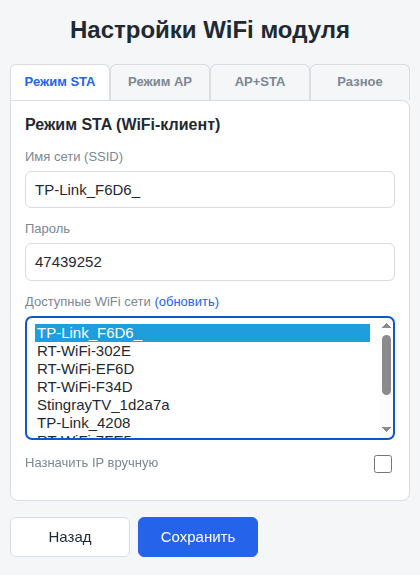
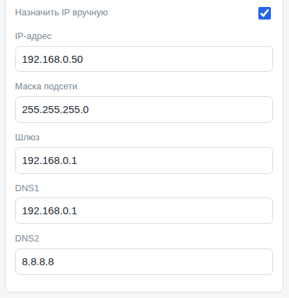
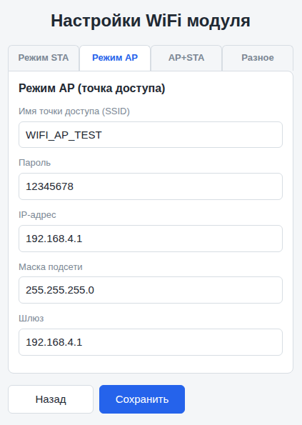
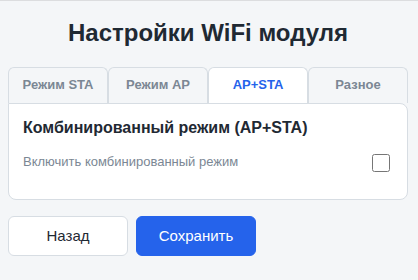
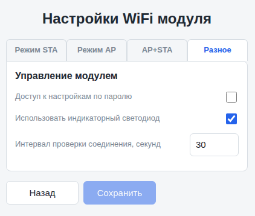
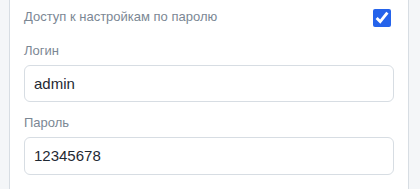

# WEB-интерфейс модулей

## Оглавление

- [Описание](#описание)
- [Режим STA](#режим-sta)
  - [Статический IP](#статический-ip)
- [Режим AP](#режим-ap)
- [AP+STA](#apsta)
- [Разное](#разное)
- [Смотри также](#смотри-также)

***Примечание:** кнопка "Сохранить" сохраняет все внесенные здесь изменения и перебрасывает браузер на главную страницу устройства ("/"); кнопка "Назад" перебрасывает браузер на главную страницу устройства без сохранения данных*

### Описание

Web-интерфейс позволяет управлять настройками WiFi-соединения. Доступ к Web-интерфейсу модуля осуществляется по адресу `http://your_ip/config_page`, где `your_ip` - IP-адрес модуля, а `config_page` - адрес страницы конфигурации (по умолчанию "/wifi_config").

***Важно!!!** доступ к Web-интерфейсу модуля может быть защищен паролем администратора*

### Режим STA

Настройки соединения с WiFi-сетью.

- **Имя сети (SSID)** - SSID сети, к которой будет подключаться модуль; длина имени контролируется - не менее 1 и не более 32 символов; использование недопустимых символов тоже контролируется;
- **Пароль** - пароль для доступа к сети; длина пароля контролируется - не менее 8 и не более 63 символов; использование недопустимых символов тоже контролируется - не более 63 символов; пустой пароль допускается;
- **Доступные WiFi-сети** - список доступных сетей; если выбрать любую из них, она будет записана в поле "Имя сети (SSID)"; если нужной вам сети в списке нет, попробуйте нажать ссылку "обновить";
- **Статический IP** - возможность задать статический IP-адрес для подключения модуля к WiFi-сети;

#### Статический IP

Если включить чек-бокс "Статический IP", появится блок для установки параметров подключения;

- **IP-адрес** - IP-адрес, который будет использоваться для подключения модуля к WiFi-сети;
- **Маска подсети** - маска подсети, которая будет использоваться для подключения модуля к WiFi-сети;
- **Шлюз** - IP-адрес шлюза, который будет использоваться для подключения модуля к WiFi-сети;
- **DNS1** - IP-адрес первого DNS сервера, который будет использоваться для подключения модуля к WiFi-сети;
- **DNS2** - IP-адрес второго DNS сервера, который будет использоваться для подключения модуля к WiFi-сети;

***Важно!!!** если ваше устройство должно будет получать данные из сети Интернет или синхронизировать время модуля через NTP, необходимо задать хотя бы DNS1*

***Примечание:** на деле достаточно заполнить поле "IP-адрес" и кликнуть на любое другое поле блока, как автоматически будут подставлены данные в поля "Маска подсети" (255.255.255.0), "Gateway" (будет подставлен адрес xxx.xxx.xxx.1 выбранной сети) и "DNS1" (будет подставлен адрес из поля "Gateway"); в большинстве случаев этого достаточно*

### Режим AP

Настройки точки доступа модуля

- **Имя точки доступа (SSID)** - SSID точки доступа; длина имени контролируется - не менее 8 и не более 16 символов; использование недопустимых символов тоже контролируется;
- **Пароль** - пароль для подключения к точке доступа; он может быть пустым, но если он не пустой, то его длина должна быть не менее 8 и не более 63 символов;
- **IP-адрес** - IP-адрес, который будет использовать точка доступа;
- **Маска подсети** - маска подсети, которая будет использоваться точкой доступа модуля;
- **Шлюз** - IP-адрес шлюза, который будет использоваться точкой доступа модуля;

***Примечание:** автоподстановка в поля "Маска подсети" и "Шлюз" выполняется аналогично вкладке "STA"*

### AP+STA

Опциональная вкладка, появляется только если при старте модуля был вызван метод `setUseComboMode()`. Подробнее [см. здесь](api.md#комбинированный-режим).

- **Включить комбинированный режим** - если включено, модуль переходит в режим AP+STA - т.е. кроме подключения к заданной во вкладке "STA" сети модуль будет одновременно создавать точку доступа с параметрами, заданными во вкладке "AP";

### Разное

Дополнительные настройки модуля

- **Доступ к настройкам по паролю** - задать логин и пароль для доступа к Web-интерфейсу модуля;

Если включить эту опцию, появляется блок для настройки логина и пароля администратора

- **Логин** - логин администратора; имя должно быть не менее 5 и не более 16 символов длиной, допускаются только символы латиницы, цифры, дефис и знак подчеркивания;
- **Пароль** - пароль администратора; длина пароля должна быть не менее 8 и не более 63 символов; не разрешаются пробелы и кириллица

- **Использовать индикаторный светодиод** - эта опция появляется, если при старте модуля был вызван метод `setUseLed()` с указанием пина, к которому подключен светодиод; если опция включена, светодиод будет использоваться для индикации режима работы модуля ([см. здесь](../readme.md#индикаторный-светодиод));

- **Интервал проверки соединения, секунд** - настройка интервала проверки WiFi-соединения; допустимый интервал - 0..600 секунд; если задать 0, модуль проверять соединение не будет;

***Примечание:** при сохранении настроек заданная здесь величина проверяется, и, если задано больше 600, интервал устанавливается равным 600 секундам*

### Смотри также

- [Главная страница](../readme.md)
- [API библиотки](api.md)