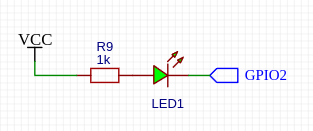

## shWiFiConfig - библиотека для настройки параметров WiFi-подключения для esp8266 и esp32

Библиотека предназначена для настройки параметров WiFi-соединения и поддержания связи. 

- [Основные возможности](#основные-возможности)
- [История версий](#история-версий)
- [Работа с библиотекой](#работа-с-библиотекой)
- [Индикаторный светодиод](#индикаторный-светодиод)
- [Шифрование (обфускация)](#шифрование-обфускация)
- [Работа с EEPROM](#работа-с-eeprom)
- [Возможные проблемы](#возможные-проблемы)
- [Зависимости](#зависимости)
- [Аддоны для ESP8266 и ESP32](#аддоны-для-esp8266-и-esp32)
  - [ESP8266](#esp8266)
  - [ESP32](#esp32)
- [Смотри также](#смотри-также)


### Основные возможности
- наличие Web-интерфейса;
- гибкая настройка параметров соединения как в режиме клиента, так и в режиме точки доступа;
- сохранение настроек в файловой системе модуля или в `EEPROM`;
- возможность шифрования (обфускации) паролей при сохранении;
- возможность использования комбинированного режима - одновременная работа модуля в качестве клиента и точки доступа;
- возможность защиты доступа к настройкам с помощью пароля администратора; так же есть возможность защиты этим же паролем любых пользовательских страниц;
- возможность использования светодиода для индикации режима работы модуля;
- постоянное отслеживание наличия соединения, переход в режим точки доступа при нарушении связи, восстановление подключения, как только вновь появляется заданная в настройках сеть;

### История версий
 Версия 1.3 - 13.11.2026
 + добавлена лицензия MIT;
 * переработан WEB-интерфейс в плане безопасности работы при использовании пароля администратора;
 * документация приведена в соответствие с API библиотеки;
 + добавлен метод `isAuthenticated()`, позволяющий организовать защиту паролем администратора любой пользовательской страницы;
 * исправлена ошибка, приводившая к невозможности обновления времени через `NTP` при статическом `IP`;
 + добавлена возможность использования флага `#define SH_LOG_OFF` перед объявлением библиотеки; флаг позволяет полностью исключить из кода вывод отладочных сообщений;
 + в Web-интерфейсе добавлена возможность задавать `DNS1` и `DNS2` для статического адреса в режиме `STA`;
 + добавлены методы `setStaDns1()`, `setStaDns2()`, `getStaDns1()` и `getStaDns2()` для установки и получения адресов `DNS` для статического адреса в режиме `STA`;
 * обновлен дизайн Web-интерфейса; 
 * метод `begin()` теперь сам загружает настройки из `EEPROM` или файловой системы, метод `loadSetting()` теперь использовать необязательно;
 * расширена документация библиотеки;
 * примеры к библиотеке приведены в соответствие с изменениями;
 * исправлена ошибка отключения светодиода на `esp32`, приводившая к том, что светодиод просто переставал изменять яркость вместо полного отключения;
 * исправлена ошибка, приводившая к зависанию быстрого мигания светодиода при потере связи; создавалось впечатление, что модуль завис в вечном поиске сети, но точка доступа при этом исправно работала;
 + в Web-интерфейсе на вкладке "Разное" добавлена возможность настройки интервала проверки соединения;
 * мелкие и не очень мелкие изменения и исправления;

 Версия 1.2 - 06.07.2025
* файлы исходников перемещены в папку `src`;
+ добавлена возможность сохранения конфигурации в `EEPROM`;
+ добавлена возможность шифрования паролей при сохранении;
+ добавлен метод `setCryptState(bool _state, String _crypt_key = "")`, позволяющий включать/отключать обфускацию паролей при сохранении и задавать ключ шифрования;
+ добавлен метод `setNoWiFiSleepMode(bool _flag)`, позволяющий отключать спящий режим `WiFi` - в этом случае контроллер не будет отключать приемо-передатчик когда `WiFi` не используется; это увеличит потребление, но позволит устройству всегда быть на связи ));
* внесены изменения в примеры для демонстрации изменений;
* убрано ограничение минимальной длины `SSID`;
+ добавлено ограничение максимальной длины пароля `WiFi` в 63 символа;
+ добавлен контроль длины `SSID` и пароля `WiFI`, устанавливаемых с помощью методов `setApSsid()` и т.д.;
+ добавлен контроль длины имени и пароля администратора для доступа к Web-интерфейсу при использовании метода `setAdminData()`;
+ добавлен метод `eepromInit(uint16_t _add_eeprom_size = 0)`, инициализирующий `EEPROM` и позволяющий выделить дополнительный размер под него;
+ добавлена проверка на нулевую длину `SSID` в Web-интерфейсе;
* мелкие изменения и исправления;

 Версия 1.1 - 18.09.2024
+ добавлен метод saveConfig() - сохранение настроек в файл;
+ добавлена документация методов библиотеки;
+ добавлена возможность вывода сообщений в заданный HardwareSerial, например, Serial1;
+ ~~добавлена поддержка использования вывода отладочных сообщений через **USB CDC** (**STM32C3**, **STM32S3** и т.д.);~~
* исправлена работа индикаторного светодиода на **ESP32** с ядром 3.0 и выше;
+ добавлена возможность настройки яркости индикаторного светодиода;
* обработка событий сервера перенесена в метод `tick()`, теперь вызывать `HTTP.handleClient();` в `loop()` не нужно;
* примеры приведены в соответствие с изменениями библиотеки;
* теперь вывод отладочных сообщений возможен в любой поток, наследующий класс **Print**, будь то **Serial**, **File**, **LCD**, и т.д.;
* мелкие изменения и исправления; 

 Версия 1.0 - 13.08.2023
+ первая публикация библиотеки;

### Работа с библиотекой

Для начала работы нужно объявить экземпляр класса. Сделать это можно двумя способами:
```
shWiFiConfig wifi_config;
```
или
```
String adm_name = "admin";
String adm_pass = "password";
shWiFiConfig wifi_config(adm_name, adm_pass);
```
где
- `adm_name` - логин администратора;
- `adm_pass` - пароль администратора для доступа к Web-интерфейсу настроек;

***ВАЖНО!!!** конструктор принимает аргументы по ссылке (`String &`), поэтому передавать нужно именованные переменные типа `String`, а не строковые литералы. Вариант `shWiFiConfig wifi_config("admin", "password");` **не скомпилируется**.*
<hr>
Если предполагается использование EEPROM для хранения настроек, перед использованием `EEPROM` ее нужно инициализировать с помощью метода:
```
void eepromInit(uint16_t _add_eeprom_size = 0);
```
где параметр `_add_eeprom_size` определяет дополнительный размер `EEPROM`, если в нем есть необходимость;

Об особенностях использования `EEPROM` библиотекой см. [здесь](docs/api.md#eeprom).
<hr>
Затем нужно инициировать конфиг:
```
wifi_config.begin(&HTTP, &FILESYSTEM);
```
где
- `HTTP` - ссылка на экземпляр Web-сервера (`ESP8266WebServer` для **esp8266** или `WebServer` для **esp32**), с которым будет работать конфиг;
- `FILESYSTEM` - ссылка на экземпляр файловой системы модуля для сохранения файла с настройками;
- третий параметр можно не использовать - это адрес страницы Web-интерфейса модуля; по умолчанию используется адрес **/wifi_config**;

или вариант с сохранением конфигурации в `EEPROM`:
```
wifi_config.begin(&HTTP);
```
где
- `HTTP` - ссылка на экземпляр Web-сервера (`ESP8266WebServer` для **esp8266** или `WebServer` для **esp32**), с которым будет работать конфиг;
- второй параметр так же можно не использовать - это адрес страницы Web-интерфейса модуля; по умолчанию используется адрес **/wifi_config**;

***Важно!!!** - метод `begin()` загружает сохраненные настройки, поэтому все предварительные настройки нужно делать до вызова этого метода, чтобы они не перекрыли данные из файла конфигурации (или EEPROM)*

***Примечание:** если файл с настройками (запись в EEPROM) не будет найден (например, при первом запуске модуля), конфиг будет использовать настройки по умолчанию, одновременно будет создан файл (запись в EEPROM) с настройками по умолчанию*
<hr>
А затем нужно установить WiFi-соединение:
```
wifi_config.startWiFi();
```
Будет выполнен поиск сохраненной сети и попытка подключения к ней, в случае неудачи будет создана точка доступа.

Имя точки доступа по умолчанию - `WIFI_AP_`, пароль точки доступа по умолчанию - `12345678`.
<hr>
Для отслеживания состояния подключения в `loop()` нужно поместить вызов метода `tick()`:
```
wifi_config.tick();
```
Проверка состояния подключения по умолчанию выполняется один раз в 30 секунд, интервал проверки можно настраивать.

При потере соединения, модуль включается в режиме точки доступа, но, как только заданная WiFi-сеть становится доступной, модуль автоматически подключается к ней.

### Индикаторный светодиод

Если планируется использовать внешний светодиод, его следует подключать так же, как подключены штатные светодиоды - анодом через токоограничивающий резистор к **VCC**, катодом к соответствующему пину. Т.е. зажигается светодиод низким уровнем на пине



поэтому при минимальном значении ШИМ будет максимальный уровень яркости светодиода и наоборот.

Если опция `setUseLed` включена, и задан пин светодиода, то индикация осуществляется следующим образом:
  
- быстрое мигание (пять раз в секунду) - поиск сети или подключение к ней; этот режим используется вне зависимости от состояния чек-бокса **"Использовать индикаторный светодиод"**;
- мигание с интервалом в одну секунду - работа в режиме точки доступа;
- плавное разгорание и затухание светодиода - модуль подключен к WiFi-сети и работает в качестве клиента; в комбинированном режиме используется такая же индикация;

о методах, предназначенных для работы со светодиодом смотрите [здесь.](docs/api.md#использование-индикаторного-светодиода)

### Шифрование (обфускация)

Используется для обфускации паролей при сохранении. Особенно актуально при сохранении параметров в файловой системе модуля.

Маскируются: имя и пароль точки доступа, пароль заданной WiFi-сети, логин и пароль администратора для доступа к Web-интерфейсу модуля.

Обфускация применяется как при сохранении параметров в файловой системе, так и при сохранении их в `EEPROM`.

По умолчанию используется 64-битный ключ шифрования. Для шифрования разных параметров используются разные участки ключа.

***Важно!!!** - обфускация - это не полноценное шифрование, а, скорее, маскировка данных; сохранение данных в `EEPROM` вместо файловой системы чуть усиливает эту защиту, но только чуть-чуть*


### Работа с EEPROM

Если вы выбрали сохранение конфигурации в `EEPROM`, то библиотека инициирует работу с `EEPROM` и выделяет под него память в размере 1026 байт (1024 байта - максимальный размер памяти, выделяемый под конфиг, плюс два байта для записи размера сохраняемых данных).

Однако, если вы планируете использовать `EEPROM` для хранения и других данных, вы можете выделить для этого дополнительный размер памяти. Для этого в методе `eepromInit()` нужно указать дополнительный размер памяти.

Если же `EEPROM` уже инициирована сторонним кодом, можно указать стартовый индекс в `EEPROM`, с которого будет сохраняться конфигурация модуля - методом `setEepromStartIndex()`. Только не забывайте, сколько места вам нужно для сохранения данных.

Об особенностях использования `EEPROM` библиотекой см. [здесь](docs/api.md#eeprom).

### Возможные проблемы

- Если у вас что-то идет не так - модуль не хочет запускаться, идет циклическая перезагрузка, не отображаются страницы Web-интерфейса, не сохраняются настройки и т.д. проверьте следующее:
  - правильно ли вы выбрали плату; если выбранная плата не соответствует реальному чипу, то прошивка может вообще не заливаться с соответствующим сообщением либо работать с ошибками (не работать вообще);
  - соответствует ли выбранный размер flash-памяти тому, который имеется на плате;
  - соответствует ли выбранная таблица разделов размеру flash-памяти и выбранному типу файловой системы;
  - для **ESP32** нужно помнить, что здесь файловая система перед использованием должна быть отформатирована с последующей перезагрузкой платы; для **ESP8266** это необязательно;

- Если вы в затруднении, какую плату вообще выбирать, то можете выбрать следующее:
  - для **ESP8266** - **NodeMCU 1.0 (ESP-12E Module)**;
  - для **ESP-01** с ее куцей памятью можно выбрать **Generic ESP8266 Module** и выбрать **Flash Size:** **1MB (FS:64kB OTA:~470kB)** и надеяться, что 470КБ хватит для вашей прошивки :) ;
  - для **ESP32** - выбрать **ESP32 Dev Module** или, если ваша **ESP32** имеет дополнительный буквенный индекс, то соответственно **ESP32C3 Dev Module**, **ESP32S2 Dev Module** и т.д.;

- При использовании пароля администратора для доступа к странице WiFi-конфигурации некоторые браузеры могут не отображать страницу, в том числе после изменения пароля или имени пользователя. В этом случае можно попробовать зайти на страницу в режиме Инкогнито. Или использовать другой браузер. Решения проблемы пока нет.

### Зависимости

Для работы модулей требуется одна сторонняя библиотека:

- [ArduinoJson.h](https://github.com/bblanchon/ArduinoJson) - работа с данными в формате JSON (код писался с использованием версии 6.21.3, ниже версии 6.0 библиотека скорее всего не будет работать, с версиями 7.0 и выше работа не тестировалась);


### Аддоны для ESP8266 и ESP32

Инструкцию по установке аддонов смотри в документации к **Arduino IDE.**

#### ESP8266

Для работы с **ESP8266** используется аддон **esp8266 by ESP8266 Community**, ссылка для установки:
- http://arduino.esp8266.com/stable/package_esp8266com_index.json

Если не знаете, какую плату выбрать, выбирайте **NodeMCU 1.0 (ESP-12E Module)**.

#### ESP32

Для работы с **ESP32** используется аддон **esp32 by Espressif Systems**, ссылка для установки:
- https://dl.espressif.com/dl/package_esp32_index.json

Если не знаете, какую плату выбрать, выбирайте **ESP32 Dev Module** (или **ESP32C3 Dev Module**, **ESP32S3 Dev Module**, **ESP32S2 Dev Module** - в зависимости от того, какой процессор используется на вашей плате).

*Для работы с МК **ESP32C2**, **ESP32C6**, **ESP32H2** требуется версия аддона не ниже **3.0**.*

<hr>

### Смотри также

- [API библиотеки](docs/api.md)
- [Web-итерфейс](docs/web.md)

<hr>

Если возникнут вопросы, пишите на valesh-soft@yandex.ru 
